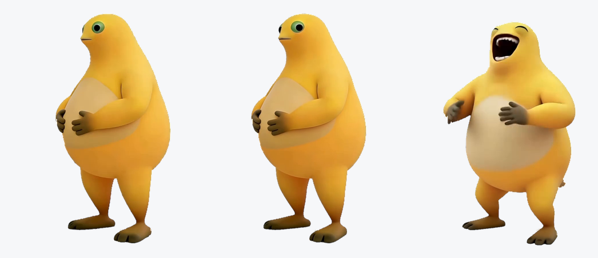
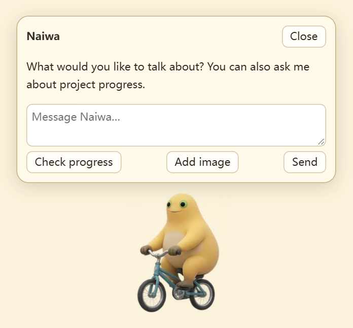

# Naiwa-ism · 奶蛙主义

[简体中文](./README.md) · English

Give your DeepSeek Harness conversations Naiwa’s playful voice. The plugin includes tools for writing, art direction, and speech rhythm, plus a [desktop pet](#desktop-pet) you can chat with. The Web panel lets you choose a persona, switch the interface language, and control the theme and end-of-turn sounds.



The preview comes from tzshuai07’s Naiwa desktop pet and is distributed under the upstream MIT license. [Original image](https://github.com/tzshuai07/naiwa/blob/main/docs/preview.png) · [Included license](./assets/naiwa-LICENSE.txt)

## Compatibility

Supported DeepSeek Harness versions are `0.2.2-rc.5` on the default channel and `0.2.3-alpha.2` on the preview channel. Running the alpha via npm or from source requires Node.js `^24.22.3 || >=26.13.1`. The desktop app includes its own runtime.

## Installation

1. Download and extract the repository, or run `git clone https://github.com/Lynn-Sunset/dsh-naiwa-ism.git`.
2. In the DeepSeek Harness plugin manager, run `install_bundle` with the **absolute path to the `plugin` subdirectory**. For example, if you cloned the repo into `D:/Projects/dsh-naiwa-ism` on Windows, use these arguments.

   ```json
   {"action": "install_bundle", "target": "D:/Projects/dsh-naiwa-ism/plugin"}
   ```

3. If the plugin manager returns `restart-required`, restart Harness. Refresh the Harness Web page and enter `/naiwa status` in a session to check the configuration.

## Desktop pet

Open **Naiwa → Pet** beside the message input and choose **Cycling**, **Ballet**, **Hopping**, or **Laughing**. In Cycling mode, Naiwa rides across the Harness page. Drag the pet to park it where you like, then click it to hear it laugh and open its own chat.



- **Chat about text or images.** Paste a screenshot and ask, “What does the button in the bottom right do?” The reply appears as it arrives. Each session keeps its chat history locally, so you can pick up after a refresh or restart. Follow-ups use the latest image, or you can select **Use this image** on an earlier one.
- **Find out where a task got stuck.** Choose **Check progress** to see recent commands alongside their results and the last error from a failed step. Expand a step to read the original command and output. The chat also shows when Naiwa is reading the session log or looking something up on the web.
- **Move the chat out of your way.** On desktop, drag anywhere in the dialog. On a touchscreen, swipe to scroll or press and hold to drag. Messages and code blocks have separate copy buttons.

<details>
<summary>Watch Naiwa hop off the bicycle, celebrate, and ride on</summary>


The six-pose jump plays when a reply finishes in the main chat or the pet’s own chat, including after a progress update. Naiwa skips the animation when your system requests reduced motion.

</details>

Pet chat and progress updates use the current session’s DeepSeek model and require a connection to the model service. Pet animations, background illustrations, and end-of-turn sounds work offline.

## Usage

To switch the panel and pet chat to English, open **奶蛙 → 界面语言 → English**. The browser remembers your choice. You can specify your preferred reply language in the conversation.

| Command or tool | What it does |
| --- | --- |
| `/naiwa strength naiwa` | Enable the Naiwa persona. |
| `/naiwa strength nailoong` | Switch to Nailoong, a curious, food-loving character. |
| `/naiwa strength off` | Turn off the persona and keep the tools available. |
| `/naiwa language zh` | Set the persona’s reply language to Chinese. Use `en` for English or `auto` to follow the user’s language. |
| `naiwa_gloss` | Give the model a five-beat writing guide and examples of Naiwa’s voice. |
| `naiwa_art` | Generate a color palette, art direction, and image prompts in Chinese and English. |
| `naiwa_speak` | Plan the rhythm of each sentence, provide examples, and flag code and URLs to preserve. |

For the full command and configuration reference, see the [plugin manual (Chinese)](./plugin/README.md).

## Tests

From the repository root, run `node --test tests/*.test.mjs` with Node.js 24. The plugin has no runtime npm dependencies.

## License

You may use, modify and distribute the original plugin code for noncommercial purposes. Commercial use requires separate prior written permission. Third-party materials follow their respective terms. [Full license](./LICENSE)
