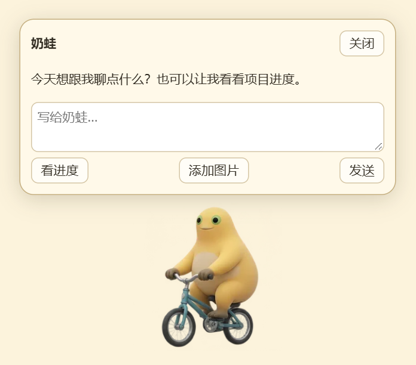

# 奶蛙主义 · Naiwa-ism

简体中文 · [English](./README.en.md)

一个给 DeepSeek Harness 会话加上奶蛙口吻的插件。它提供叙事、美术提示词和语言节奏三个工具，也可以在 Web 面板里切换人格、语言、皮肤与回合结束提示音。想让奶蛙陪你聊天、看项目进度，可以开启[奶蛙桌宠](#奶蛙桌宠)。


预览图来自 [tzshuai07 的奶蛙桌宠](https://github.com/tzshuai07/naiwa/blob/main/docs/preview.png)，随图附上[上游 MIT 许可证](./assets/naiwa-LICENSE.txt)。

## 宿主版本

适配 DeepSeek Harness 默认渠道 `0.2.2-rc.5` 和预览渠道 `0.2.3-alpha.2`。使用 npm 或源码运行 alpha 版时，宿主要求 Node.js `^24.22.3 || >=26.13.1`；桌面版自带运行时。

## 安装

1. 下载并解压此仓库，或运行 `git clone https://github.com/Lynn-Sunset/dsh-naiwa-ism.git`。
2. 在 DeepSeek Harness 的插件管理器中执行 `install_bundle`，目标填本机 **plugin 子目录的绝对路径**。例如，仓库位于 Windows 的 `D:/Projects/dsh-naiwa-ism` 时，参数如下。

   ```json
   {"action": "install_bundle", "target": "D:/Projects/dsh-naiwa-ism/plugin"}
   ```

3. 如果插件管理器返回 `restart-required`，先重启 Harness。刷新 Harness Web 页面，在会话中输入 `/naiwa status` 检查当前配置。

## 奶蛙桌宠

打开会话输入框旁的 **奶蛙 → 桌宠**，选择 **骑车、芭蕾、蹦跳** 或 **捧腹大笑**，奶蛙就会出现在 Harness 页面上。骑车时它会横穿页面。把它拖到喜欢的位置，轻点一下，它会笑出声并打开自己的聊天框。



- **聊文字，也聊图片。** 粘贴一张界面截图，问问奶蛙右下角的按钮有什么用，它会逐段回复。聊天记录按会话保存在本机，刷新或重启后还能继续。追问默认沿用最近一张图，也可以翻到旧图，点「引用这张图」。
- **点「看进度」找出卡在哪一步。** 奶蛙会把近期命令和执行结果配在一起，失败时显示末尾报错。展开对应步骤，就能读命令和输出原文。读记录、查网页时，聊天框也会显示奶蛙正在做什么。
- **把聊天框放在顺手的位置。** 桌面端可从框内任意位置拖动。在触屏上，滑动可翻阅消息，长按后可拖动。消息和代码块都可以单独复制。

<details>
<summary>看奶蛙停下骑车、庆祝跳跃，再接着骑（动图）</summary>


主聊天、桌宠聊天或「看进度」的回复正常结束时都会触发这套六姿势动作。开启系统的「减少动态效果」后，奶蛙会跳过庆祝动画。

</details>

闲聊和「看进度」使用当前会话的 DeepSeek 模型，需要连接模型服务。桌宠动作、背景插画和回合完成提示音均可离线使用。

## 使用

| 操作 | 用途 |
| --- | --- |
| `/naiwa strength naiwa` | 启用奶蛙人格 |
| `/naiwa strength 奶龙` | 切换为好奇、爱吃的奶龙人格 |
| `/naiwa strength off` | 关闭人格，保留工具 |
| `/naiwa language zh` | 将回答语言设为中文 |
| `naiwa_gloss` | 提供五拍写作指引和独立的语感示例，由模型据此写作 |
| `naiwa_art` | 生成配色、美术指导和中英绘图提示词 |
| `naiwa_speak` | 提供逐句节奏计划和示例，标记需要保留的代码与网址 |

完整命令和配置见[插件手册](plugin/README.md)。

## 验证

从仓库根目录使用 Node.js 24 运行 `node --test tests/*.test.mjs`。插件没有运行时 npm 依赖。

## 许可

插件原创代码允许非商业使用、修改和分发。商业使用须事先取得相关权利人的书面授权。第三方素材按各自的许可条款使用。[完整许可证](./LICENSE)
